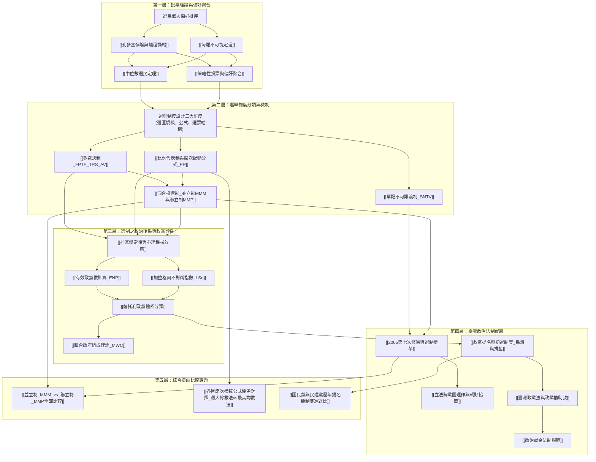

---
title: 政黨與選舉制度知識庫全景總覽
aliases: [Wiki Overview, 理論架構圖, 全景導航]
category: overview
tags: [政治學, 總覽, 導航, 選舉制度, 政黨體系]
sources: ["[[AGENTS.md]]"]
updated: 2026-11-19
---

# 政黨與選舉制度知識庫全景總覽 (Theoretical Architecture Overview)

歡迎查閱 **「政黨與選舉制度」LLM Wiki**。本知識庫立足於國立臺灣大學政治學系王業立教授講授、張建邦整理之經典教材體系，依據 Andrej Karpathy 的 LLM Wiki 架構將 12 份原始教材深度編譯為具有完整交叉鏈結（Wikilinks）的長青知識網絡。

---

## 一、 理論脈絡演進地圖 (Conceptual Flowchart)

政治學中關於政黨與選舉制度的研究，遵循著嚴密的邏輯遞進關係：**從「微觀個人偏好如何加總」，到「選舉制度如何將選票轉為席次」，再到「席次結構如何形塑政黨生態與內閣政府」，最後落實於「國家具體憲政法制」**。

---

## 二、 知識庫五大主題領域導引

### 1. 核心理論與定理 (`concepts/`)
探討民主決策與投票數學的底層邏輯：
- [[阿羅不可能定理]]：集體決策無矛盾滿足五項民主條件之不可能證明。
- [[孔多塞悖論與議程操縱]]：循環多數困境與議事排程主導權。
- [[中位數選民定理]]：單峰偏好下兩黨競爭的中間向心收斂規律。
- [[策略性投票與偏好聚合]]：棄保效應、吉巴德-薩特斯韋特定理與各大表決計算法。
- [[杜瓦傑定律與心理機械效應]]：選制形塑兩黨或多黨之經典物理學式法則。
- [[有效政黨數計算_ENP]]：拉克索與塔格佩拉量化政黨實力指標（$N_v, N_s$）。
- [[加拉格爾不對稱指數_LSq]]：最小平方法精確量化票席失衡程度。

### 2. 各國選舉制度分類 (`systems/`)
解析全球各大民主國家選制運作機制：
- [[多數決制_FPTP_TRS_AV]]：領先者當選制、法國兩輪決選制、澳洲選擇投票制。
- [[比例代表制與席次配額公式_PR]]：最大餘數法（黑爾、特羅普）與最高均數法（漢狄、聖拉古）、STV制。
- [[混合投票制_並立制MMM與聯立制MMP]]：並立制與德式聯立制、超額與平衡席次。
- [[單記不可讓渡制_SNTV]]：臺灣與日本歷史舊制、配票技術與派系病理。

### 3. 政黨政治與政府運作 (`party_politics/`)
分析政黨競爭型態與權力分贓：
- [[薩托利政黨體系分類]]：一黨獨大、兩黨制、溫和多黨制與極化多黨制八大病徵。
- [[聯合政府組成理論_MWC]]：最小獲勝聯合、意識形態相鄰聯合與少數政府。
- [[政黨提名與初選制度_民調與排藍]]：雷尼甄選光譜、臺灣特色電話民調與排藍爭議。

### 4. 臺灣制度與憲政運作 (`taiwan_institutions/`)
深耕臺灣本土公法與政治實務：
- [[2005第七次修憲與選制變革]]：立委減半、單一選區兩票並立制之確立與衝擊。
- [[臺灣政黨法與政黨補助款]]：法人化、殭屍政黨淘汰、3% 每年每票 50 元補助款。
- [[政治獻金法制規範]]：專戶監管、企業與個人捐贈上限、防範境外金流。
- [[立法院黨團運作與朝野協商]]：3 席黨團門檻、一個月協商冷凍期與朝野折衝。

### 5. 橫向綜合比較專案 (`comparisons/`)
深入演算與跨維度比對：
- [[並立制_MMM_vs_聯立制_MMP全面比較]]：模型演算、票席落差與修憲決策評析。
- [[各國席次換算公式優劣對照_最大餘數法vs最高均數法]]：阿拉巴馬悖論與漢狄法偏向大黨驗證。
- [[國民黨與民進黨歷年提名機制演進對比]]：由威權指派、黨員初選到全民調之歷史編年。

---

## 相關核心檔案
- 完整條目索引：[[index]]
- 維護日誌：[[log]]
- 架構規範手冊：[[AGENTS.md]]
